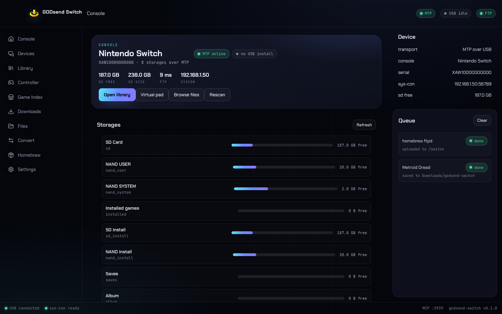
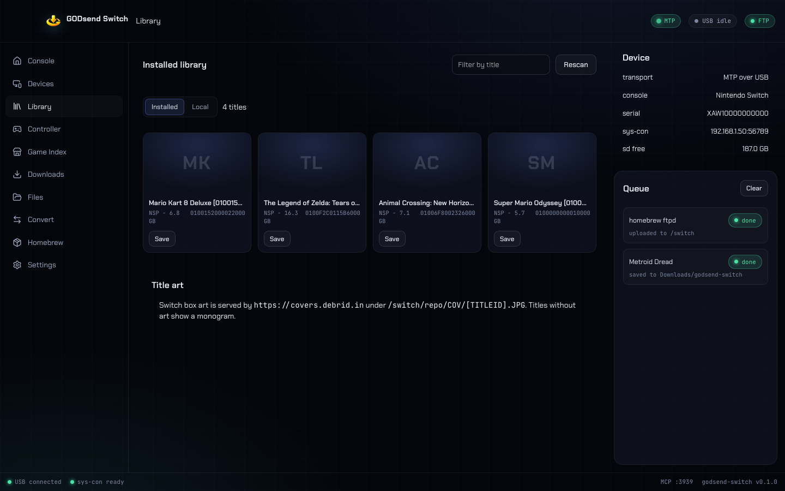

# GODsend Switch

[](https://ghostyshell.github.io/godsend-switch/)
[](https://discord.gg/d3sFnrgpJn)
[](https://ko-fi.com/ghosty99)
[](https://etherscan.io/address/0xbBef115aD853236a350EaF04777a2AdB2e7c0317)

A desktop workshop for a homebrew-enabled Nintendo Switch: connect over USB,
manage the installed library, install games and homebrew, drive the console
with a virtual controller, and convert the files Switch tools use. Same
family look and feel as GODsend 360 and GODsend PSP, built on the Keepsake
Atelier stack (Rust engine + Tauri 2 + React).

| Console | Library |
| --- | --- |
|  |  |

## What it does

- **USB, three ways**: MTP (DBI, Sphaira), the Tinfoil/Awoo bulk install
  protocol, and the LAN installer on TCP 2000. FTP covers consoles without
  USB access.
- **Library**: reads the MTP responder's "Installed games" storage plus the
  SD card, parses NSP/NSZ/XCI/XCZ names for title ids, shows box art from
  the cover base with monograms as the fallback, and lists local packages
  beside what is installed.
- **Installs**: send an NSP/NSZ/XCI/XCZ straight to "SD install" or "NAND
  install" (DBI installs on arrival), over Tinfoil USB, or to the LAN
  installer. NRO homebrew always goes to `/switch` on the SD card.
- **Files**: browse any MTP storage and the local disk side by side, upload,
  download, create folders, delete.
- **Virtual controller**: sys-con's network controller over UDP. Every face
  and shoulder button, D-pad, both sticks, HOME and Capture, with keyboard
  mapping and press-and-hold.
- **Game Index**: search a Switch game index or the Internet Archive, resolve
  through Real-Debrid or TorBox, and download with aria2c (16 connections,
  single-connection fallback).
- **Downloads**: one folder for everything, with send-to-console, reveal and
  delete.
- **Homebrew**: catalog of GitHub NRO projects (Homebrew App Store, ftpd,
  sys-con, NX-Shell, DBI, Awoo Installer, sys-ftpd, NXThemes Installer),
  fetched from each project's latest release.
- **Conversions**: FAT32 split into `.00`, `.01` parts and merge back, NSP
  format and title-id inspection.
- **MCP server**: starts with the app on `127.0.0.1:3939/mcp`, so an agent can
  read status, browse storages, install files, drive the pad and search the
  index. The CLI also serves the same tools over stdio.
- **Preflight**: one panel for the MTP responder, install storage, Tinfoil
  mode, FTP host, sys-con, download folder, aria2c, debrid and the MCP port.

## Guides

Step-by-step walkthroughs live in [docs/guides](docs/guides/index.md):

1. [Connect your Switch](docs/guides/connect-your-switch.md)
2. [Installing games](docs/guides/installing-games.md)
3. [Homebrew and sys-con](docs/guides/homebrew-and-syscon.md)
4. [Virtual controller](docs/guides/controller.md)
5. [Conversions](docs/guides/conversions.md)
6. [Troubleshooting](docs/guides/troubleshooting.md)
7. [Build from source](docs/guides/build-from-source.md)

## Download

<!-- downloads:start -->
| Build | GoFile (primary) | file.kiwi (backup) | Size |
| --- | --- | --- | --- |
| pending | pending | pending | |
<!-- downloads:end -->

GoFile is the primary host and file.kiwi is the encrypted backup. Links are
refreshed by `scripts/publish-release.sh`, which rebuilds every platform on
CI, uploads the artifacts, and rewrites this table and
`docs/downloads.json`.

The desktop builds are not notarized: right-click, Open, Open on first launch
(or `xattr -dr com.apple.quarantine "/Applications/GODsend Switch.app"`).

## Build from source

Requirements: Rust 1.85+, Node 20+, and the Tauri 2 prerequisites for your
platform (Xcode CLT on macOS, MSVC + WebView2 on Windows, webkit2gtk-4.1 on
Linux). Details in
[docs/guides/build-from-source.md](docs/guides/build-from-source.md).

```sh
npm install --prefix app
npx --prefix app tauri icon app/src-tauri/icons/icon.png   # once
cargo build --release -p godsend-switch-cli                # CLI
npx --prefix app tauri build                               # desktop bundles
```

Dev without a console:

```sh
npm run --prefix app dev:mock    # UI with fixture data (?mock=1)
npm run --prefix app test:ui     # Playwright against the mock bridge
```

CLI quick tour:

```sh
godsend-switch status            # MTP, Tinfoil USB, FTP, sys-con
godsend-switch storages          # storage units with free space
godsend-switch library           # installed titles
godsend-switch install game.nsp  # configured transport
godsend-switch install game.nsp --via tinfoil
godsend-switch pad a             # sys-con virtual pad
godsend-switch stick l 0 -1      # left stick up
godsend-switch homebrew-install sys-con
godsend-switch split game.nsp    # FAT32 parts
godsend-switch mcp               # MCP over stdio
```

## MCP

The app hosts the MCP endpoint while it runs. This repo ships a `.mcp.json`
that points at it; elsewhere register it once:

```sh
claude mcp add --transport http godsend-switch http://127.0.0.1:3939/mcp
```

Tools: `switch_status`, `doctor`, `list_storages`, `list_storage`, `library`,
`install_file`, `pad`, `search_games`, `homebrew`, `nsp_split`, `nsp_merge`.
A port change or the on/off toggle applies as soon as you press Save in
Settings. The CLI's `mcp` command speaks the same JSON-RPC over stdio for
clients that spawn their own server.

## What the console needs

- A homebrew-enabled Switch (Atmosphere). USB transfers need a responder
  running in MTP mode (DBI's "Run MTP responder", or Sphaira); the bulk
  installer path needs a Tinfoil/Awoo-family installer in USB mode. FTP needs
  ftpd or sys-ftpd.
- The virtual pad needs sys-con with `network_controller=1` in its config;
  the default UDP port is 56789.
- Nothing is decrypted or signed: NSZ/XCZ decompression and XCI to NSP need
  console keys and are out of scope.

## Architecture

```
core/            godsend-core: MTP, Tinfoil USB, LAN install, FTP, library,
                 NSP tools, sys-con pad, homebrew, store, debrid, downloads,
                 files, jobs, doctor, config, MCP.
cli/             godsend-switch headless CLI.
app/             Tauri 2 desktop app: React 18 + TypeScript, 44 commands in
                 app/src-tauri, events for job progress, MCP server on start.
```

See [DESIGN.md](DESIGN.md) for the design system and
[docs/features.md](docs/features.md) for the feature reference.

## License

MIT. Not affiliated with Nintendo. Use with content you own.
